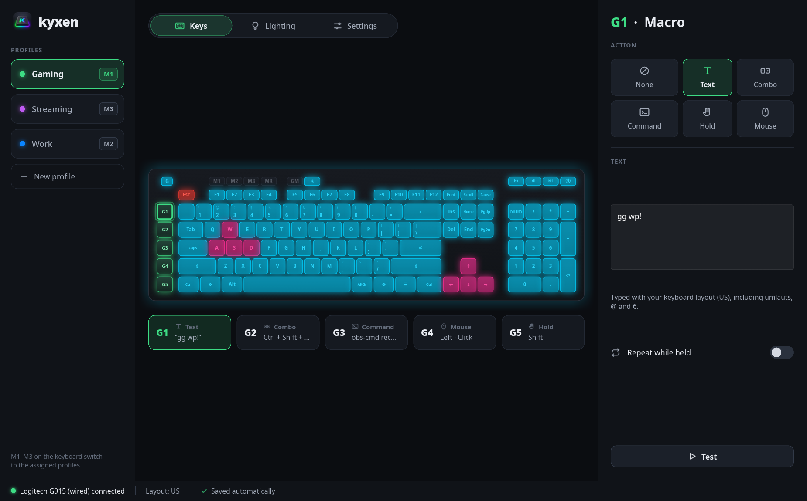
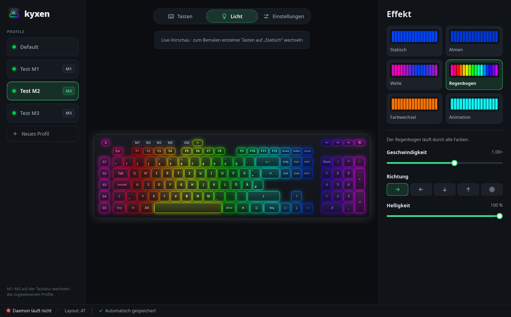

# kyxen-rs

G-key macros, M-key profiles and per-key RGB lighting for Logitech gaming
keyboards on Linux — a Rust rewrite of [Kyxen](https://github.com/quinn-stack/kyxen).

No Windows software, no cloud account, no Python runtime: one daemon binary.

## Supported keyboards

| Model | G-keys | M-keys | Lighting | Status |
|-------|--------|--------|----------|--------|
| Logitech G915 (USB cable) | G1–G5 via HID++ — no flash writes | M1–M3 + LEDs | per-key, presets, animations | tested on hardware |
| Logitech G815 | G1–G5 via flash remap (as in Kyxen) | M1–M3 + LEDs | per-key, presets, animations | ported, not yet tested on hardware |

The G915 over its LIGHTSPEED receiver is not supported yet.

> **Use at your own risk.** Kyxen is an unofficial hobby project, not affiliated
> with or endorsed by Logitech, and comes without any warranty (see
> [Disclaimer](#disclaimer)). On the G815 it writes a G-key remap to the
> keyboard's flash memory (a backup is kept); on the G915 nothing is written
> to flash.

## Help support your keyboard

You don't need to write code to help: Kyxen can write a report with what we
need to know about a keyboard.

1. In the app: **Settings → Help → Create report**. It saves
   `kyxen-report-<date>.md` to your Downloads folder.
   In a terminal: `kyxend report` (writes to the current folder).
2. If it says it has no access to a device (a receiver, or a model Kyxen
   doesn't know yet), run `sudo kyxend report` for the full details.
3. Read the file if you like, then attach it to a
   [keyboard report issue](https://github.com/Piktrip/kyxen-rs/issues/new?template=keyboard-report.yml).

The report is read-only: it only sends HID++ *get* requests (listed at the end
of every report) and changes nothing on the keyboard. It contains no serial
numbers, unit ids, user or host names. Running it is still at your own risk.

## What's different from Python Kyxen

- **Feature indices and sector sizes are read from the keyboard**, not hardcoded — they differ between models and firmware (e.g. per-key lighting is `0x10` on the G815, `0x0a` on a G915).
- **G915 G-keys come as HID++ notifications**: nothing is written to the keyboard's flash and the keyboard is not grabbed, so normal typing never goes through the daemon.
- **The keyboard is handed back in onboard mode** with the profile that was active before the daemon started (Kyxen left it in host mode).
- **Reconnects** after the keyboard is unplugged instead of exiting.
- **Repeating macros run one after another** instead of typing over each other.
- **Text macros** type correctly on `us`, `gb`, `de` and `at` layouts, including AltGr characters, umlauts and dead keys; the tables are checked against xkbcommon in the test suite.
- The control socket is private to the user (`0600`) and a second daemon refuses to start.

Config files and the control socket are compatible with Python Kyxen, so its
GUI keeps working with this daemon.

## Build and install

```bash
cargo build --release
./target/release/kyxend install
```

Requires Rust 1.88+ (edition 2024). `install` works per user, without root:

- copies `kyxend` and the `kyxen` app to `~/.local/bin`
- installs and starts the systemd user service `kyxend.service` (runs with your desktop session)
- adds Kyxen to the app launcher and starts the tray icon at login (`--no-tray` to skip)

`kyxend uninstall` removes all of it; your config in `~/.config/kyxen` stays.

## The app

`kyxen` opens the settings app: profiles, G-key macros (record a combo by
pressing it), per-key painting, effects with live preview. Changes are saved
automatically and applied by the daemon immediately. Closing the window keeps
Kyxen in the tray; the tray menu switches profiles. `kyxen --tray` starts
hidden.

The app speaks English and German (follows the system language, or pick one
under Settings → App). The on-screen keyboard comes in ISO (DE, AT, UK) and
ANSI (US) form; by default US layouts get ANSI. On an ANSI board the key above
Enter is `ANSI_BACKSLASH` in profile files (not yet tested on hardware).

More languages: copy `crates/kyxen-gui/lang/de` to `lang/<code>` and translate
the `.po` file.




## Permissions

The daemon needs the keyboard's `/dev/hidraw*` nodes and `/dev/uinput`.
Grant the hidraw nodes to the logged-in user with a udev rule:

```bash
echo 'KERNEL=="hidraw*", ATTRS{idVendor}=="046d", ATTRS{idProduct}=="c33e|c33f", TAG+="uaccess"' \
  | sudo tee /etc/udev/rules.d/70-kyxen.rules
sudo udevadm control --reload-rules && sudo udevadm trigger
```

The G815 path also grabs the keyboard's `/dev/input/event*` node; add
`SUBSYSTEM=="input", KERNEL=="event*", ATTRS{idVendor}=="046d", ATTRS{idProduct}=="c33f", TAG+="uaccess"`
to the same file for it.

## Usage

```bash
kyxend              # run the daemon
kyxend probe        # show the keyboard and its HID++ features (read-only)
kyxend status       # ask the running daemon
kyxend switch NAME  # switch profile
kyxend reload       # reload config files
kyxend report       # read-only hardware report for a support request
kyxend restore [N]  # put the keyboard back into onboard mode on profile N
```

Set `RUST_LOG=debug` for more detail.

## Configuration

`~/.config/kyxen/config.toml`:

```toml
active_profile = "default"
keyboard_layout = "at"          # optional, else taken from localectl
keyboard_variant = "nodeadkeys" # optional
keyboard_form = "ansi"          # optional: iso | ansi, else ANSI for "us"
language = "en"                 # optional app language: de | en, else system
tray = false                    # optional: no tray icon

[profile_slots]
m1 = "default"
m2 = "gaming"
m3 = "work"
```

`~/.config/kyxen/profiles/<name>.toml`:

```toml
name = "default"
display_name = "Default"

[g1]
action = "type"            # type | command | combo | hold_toggle | mouse_button
text = "Grüße @ äöü"

[g2]
action = "combo"
keys = ["ctrl", "z"]

[g3]
action = "command"
cmd = "notify-send Kyxen 'G3 pressed'"

[g4]
action = "mouse_button"
mouse_btn = "left"         # left | right | middle | button4 | button5
mouse_mode = "click"       # click | double_click | hold
repeat = true
repeat_rate = 50           # ms

[lighting]
mode = "preset"            # static | preset | animation
base_colour = "#00cc44"

[lighting.preset]
name = "rainbow_wave"      # breathing | wave | rainbow_wave | colour_cycle
direction = "left_right"   # left_right | right_left | top_bottom | bottom_top | radial
speed = 1.0
```

Static per-key colours go in `[lighting.keys]` (`W = "#ffffff"`); slide
animations in `[[lighting.animation.slides]]` with `keys`, `hold`,
`transition` (`cut`, `fade`, `ease`, `hsv`, `wipe_*`, `blink`) and
`transition_duration`.

## Layout

| Crate | Purpose |
|-------|---------|
| `kyxen-hidpp` | HID++ 2.0: transport, feature lookup, onboard profiles, lighting reports, notifications. Includes an in-memory G915 for tests. |
| `kyxen-core` | Config files, text layouts, macro translation, key geometry, lighting effects. No I/O. |
| `kyxend` | The daemon and CLI. |
| `kyxen-gui` | The `kyxen` app (Slint) and tray icon. |
| `kyxen-report` | Read-only hardware report (app: Settings → Help, `kyxend report`). |

```bash
cargo test --workspace
cargo clippy --workspace --all-targets
```

## Disclaimer

Kyxen is provided "as is", without warranty of any kind, as stated in
sections 15 and 16 of the GPL-3.0. You use it at your own risk; the authors
are not liable for any damage to hardware, data or anything else.

Kyxen is not affiliated with, endorsed by or supported by Logitech.
Logitech, G815, G915 and LIGHTSPEED are trademarks of Logitech. The protocol
knowledge comes from observing the devices and from the original Kyxen.

## Credits and licence

Based on [Kyxen](https://github.com/quinn-stack/kyxen) by Wade Quinn and
contributors; the protocol knowledge, key maps and config format come from
there. Rewritten in Rust with AI assistance (Claude, by Anthropic).

GNU General Public License v3.0 or later — see [LICENSE](LICENSE).
